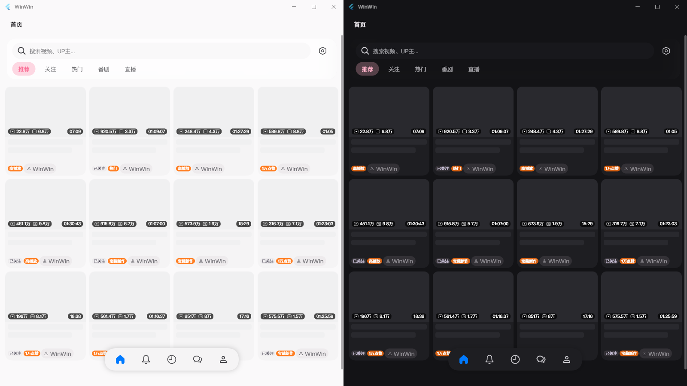
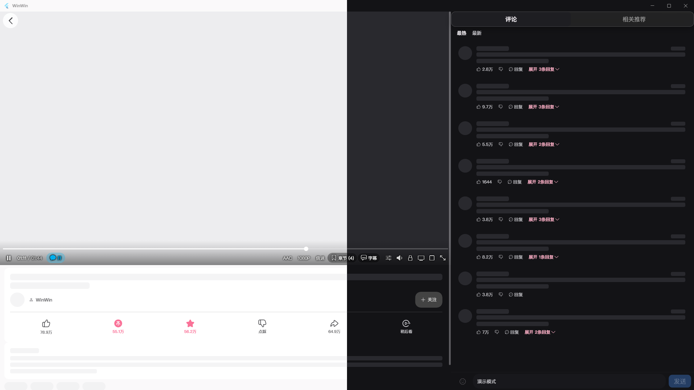
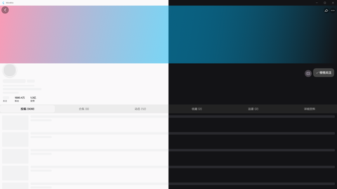
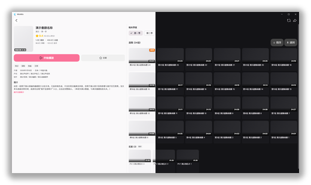
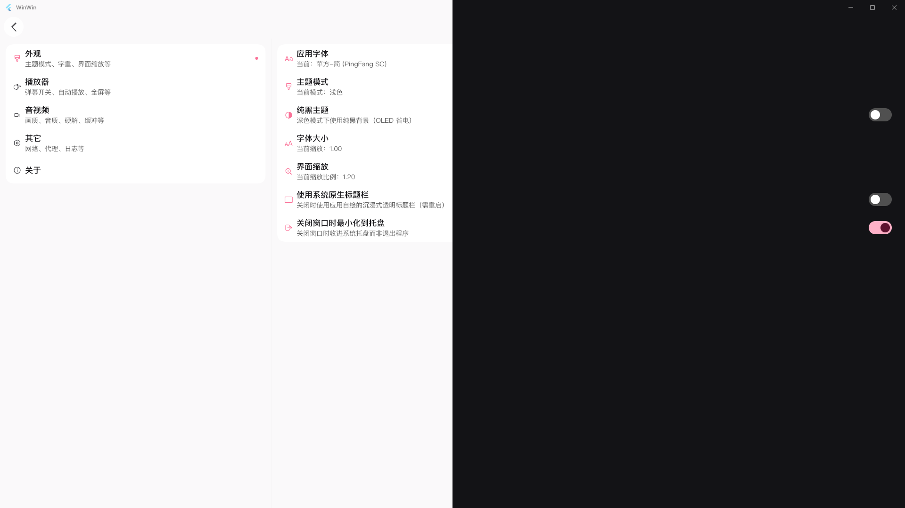

<div align="center">

# WinWin

**小破站桌面端 ( ゜-゜)つロ 干杯~**

基于 **PiliPlus** 做桌面化改造的 Windows 桌面客户端 —— 替换播放内核（fvp / libmdk）、重做视觉体系（Miuix）。

[](LICENSE)
[]()
[](https://flutter.dev)
[]()
[](https://github.com/bggRGjQaUbCoE/PiliPlus)

</div>

<p align="center">
  <a href="assets/flutter_logo.png"></a>
</p>

> WinWin 是 [PiliPlus](https://github.com/bggRGjQaUbCoE/PiliPlus) 在 **Windows 桌面方向** 的改进分支：替换了播放内核（media_kit → **fvp / libmdk**），并把前端实现逐步重做为一套桌面化视觉体系。
>
> 早期界面设计参考过 [BiliPai](https://github.com/jay3-yy/BiliPai) 的前端设计，并把它若干 Kotlin 策略与交互逻辑逐条移植为 Dart；接口细节参考 [bilibili-API-collect](https://github.com/SocialSisterYi/bilibili-API-collect) 的公开文档。
>
> 本项目以 **vibe coding（AI 辅助编程）方式开发**：代码由 AI 编程助手协作产出，经运行验证与人工审阅。

---

## 🖼️ 程序演示模式截图

> 以下均为 **演示模式**（`设置 → 其它设置 → 演示模式`）下的干净截图：云端内容与账号标识被替换为占位，不含第三方素材。

<table align="center">
  <tr>
    <td colspan="2" align="center" valign="top">
      <a href="assets/screenshots/01-home.png"></a><br>
      <sub><b>根页面（首页）</b>：左侧导航栏 + 推荐 / 关注 / 热门 / 番剧 / 直播 分组推荐流。</sub>
    </td>
  </tr>
  <tr>
    <td width="50%" align="center" valign="top">
      <a href="assets/screenshots/02-player.png"></a><br>
      <sub><b>播放页</b>：播放器与控制栏、稿件互动区，右侧评论 / 相关推荐。</sub>
    </td>
    <td width="50%" align="center" valign="top">
      <a href="assets/screenshots/03-space.png"></a><br>
      <sub><b>用户空间</b>：头图 + 资料卡 + 投稿 / 合集 / 动态 标签页。</sub>
    </td>
  </tr>
  <tr>
    <td width="50%" align="center" valign="top">
      <a href="assets/screenshots/04-bangumi.png"></a><br>
      <sub><b>番剧详情页</b>：海报 / 评分与追番数据、开始播放与追番；右侧相关季度切换、选集网格与花絮特典。</sub>
    </td>
    <td width="50%" align="center" valign="top">
      <a href="assets/screenshots/05-setting.png"></a><br>
      <sub><b>设置页</b>：左侧分类导航 + 右侧分组设置项（含滑块与开关）。</sub>
    </td>
  </tr>
</table>

---

## 🎯 项目定位

| 能力 | 上游基线 | WinWin |
|---|---|---|
| 视频 / 番剧 / 直播播放 | ✅ | ✅ 复用骨架，替换播放内核 |
| 弹幕 / 评论互动 | ✅ | ✅ 复用骨架 + 桌面端交互适配 |
| 动态 / 消息中心 | ✅ | ✅ 复用骨架 + 私信 Inbox 套件 |
| 搜索 / 个人空间 / 收藏 / 历史 / 稍后再看 | ✅ | ✅ 复用骨架，并做响应式排版对齐 |
| 播放内核 | media_kit（libmpv 系） | ✅ 替换为 **fvp / libmdk** |
| 视觉体系 | 各自风格 | ✅ **Miuix（flutter_miuix）** 为唯一维护风格 |
| 桌面适配 | — | ✅ 侧边栏导航 / 沉浸式标题栏 / 伪 PiP / 键鼠交互 |
| 网络实现 | 完整 gRPC 栈 | ✅ 以 HTTP 方案替代（桌面单用户场景收益有限） |
| 凭据存储 | 明文 Hive | ✅ **凭据加密落盘**（相对上游的改进） |
| 自有修复积累 | — | ✅ Seek 音画同步 / 缓冲冻结 / 内存增长 / 弱网容错 等（见 `docs/`） |

---

## ✨ 本项目新增与差异

### 2.1 主要差异

- **来源与定位**：以 PiliPlus 为基础进行 Windows 桌面化改造；早期界面设计参考 BiliPai 前端设计，现前端实现已切换为 flutter_miuix（Miuix）体系；
- **播放内核替换**：media_kit（libmpv 系）→ **fvp / libmdk**。缘由：media_kit 捆绑的 libmpv 二进制停更于 2023-09、Dart 层维护迟滞；fvp/mdk 维护活跃（按月发版）、默认硬件解码、**原生外挂音轨**（`setMedia(url, audio)`）对 B 站 DASH 分离音视频流支持更干净，且趁播放器代码量小时迁移成本最低；
- **平台适配**：针对桌面适配侧边栏导航、窗口标题栏沉浸、伪 PiP、键鼠交互；
- **UI 体系**：以 flutter_miuix（Miuix）为唯一维护风格——Material 3 已完全移除，历史 iOS 风格已并入 Miuix；后续可能引入液态玻璃（Liquid Glass）风格；
- **网络实现**：以 HTTP 方案替代完整 gRPC 栈（桌面单用户场景收益有限）；
- **BiliPai 策略吸收**：将其 Kotlin 策略与交互逻辑逐条移植为 Dart 并做桌面化边界修复；
- **自有修复积累**：凭据加密落盘（上游为明文 Hive）、Seek 音画同步、缓冲冻结死锁、播放期内存增长、弱网容错、音频响度对齐、历史续播、番剧片尾跳过、风控弹窗承载、崩溃报告处理等（详见 `docs/` 复盘文档）。

### 2.2 不足与局限

- 仅面向 Windows，其他平台未适配；
- 下载系统与插件系统尚未完成（路线图中）；
- 部分增强未完成：超分（Anime4K / FSR）、SponsorBlock 提交 / 投票等；
- 依赖系统 WebView2 与显卡解码能力，个别环境需实测验证；
- 相对上游裁剪了桌面场景不需要的模块（如部分 gRPC / 移动端专属实现）。

---

## 🧩 功能模块与上游来源对照

本项目各功能模块与上游的对应关系如下（各源码文件头均保留「移植自 / 对标 / 参考」标记）：

| 功能模块 | 上游来源 | 主要移植内容 |
| --- | --- | --- |
| 应用骨架 / 导航 | PiliPlus | `MainLayout` 三槽位布局、`SimpleScaffold`、沉浸式标题栏、桌面全屏与窗口定位 |
| 网络与请求层 | PiliPlus | 统一请求封装（buvid 激活 / UA / 超时对齐）、风控规避参数、错误文案映射 |
| 业务接口模块（20+ HTTP） | PiliPlus | 视频 / 评论 / 弹幕 / 直播 / 动态 / 消息 / 搜索 / 收藏 / 历史 / 稍后再看 / 番剧 / 音乐 / 用户空间 / 关注 / 粉丝 / 黑名单 / 下载 / 人机验证等 |
| 签名与 ID 工具 | PiliPlus | WBI 签名（`wbi_sign`）、BV↔AV 等 ID 转换、弹幕工具集 |
| 账号与登录 | PiliPlus + BiliPai | PiliPlus：账户服务 / 登录守卫 / 登录页 / 极验弹窗；BiliPai：会话 CookieJar（`AppSessionCookieJar`） |
| 播放控制与交互 | PiliPlus | 全局单例播放器（引用计数）、拖动 / 心跳 / 返回重建等交互骨架、PGC 播放体系 |
| 播放策略与容错 | BiliPai | `VideoLoadPolicy` / `NetworkFallbackPolicy` / `HeartbeatPolicy` / `StreamSelectionPolicy` / 卡死自愈 / 错误恢复；番剧 OP/ED 跳过与自动连播 |
| 弹幕体系 | PiliPlus + BiliPai | PiliPlus：段弹幕 HTTP / 屏蔽规则同步 / 控制器与工具；BiliPai：protobuf 手写解析器、类型 / 关键词 / 指令过滤、发送面板策略 |
| 评论与内容安全 | PiliPlus + BiliPai | PiliPlus：HTTP 骨架；BiliPai：三级容灾回退、评论反诈、首页推荐匿名化、排序与容错 |
| 动态 / 消息中心 | PiliPlus + BiliPai | PiliPlus：动态流与页面骨架；BiliPai：私信 Inbox 套件（分页策略 / 用户解析 / 预览解析） |
| 搜索 / 空间 / 收藏 / 历史 / 稍后再看 | PiliPlus + BiliPai | PiliPlus：HTTP 与页面；BiliPai：响应式排版规范与交互对齐 |
| 空降助手 | BiliPai + BilibiliSponsorBlock | 用例移植（`SponsorBlockUseCase`）+ 段落数据 API（bsbsb.top 镜像） |
| 日志 / 启动 / 配置 | PiliPlus + BiliPai | PiliPlus 骨架 + BiliPai 增强（环形缓冲落盘 / 脱敏 / 启动任务编排 / 配置加载守卫） |
| UI 组件与设计系统 | flutter_miuix + BiliPai | Miuix 组件体系（唯一风格）；BiliPai 设计 tokens（`BiliDesign` / 对比度策略 / 动效 tokens） |
| 接口协议与文档 | bilibili-API-collect | WBI / APP 签名、视频流地址、gRPC 协议定义（`grpc_api`） |
| 播放内核 | fvp / libmdk（第三方库，非移植） | 硬件解码 / D3D11 渲染 |
| 凭据安全（自研增强） | 相对 PiliPlus 的改进 | 上游为明文 Hive 存储；WinWin 增加加密落盘 |

---

## 📦 上游已有能力（本项目继续提供）

| | 能力 |
|:---:|---|
| ✅ | **完整观看链路** —— 视频 / 番剧 / 直播播放、选集、倍速、清晰度与音量归一（loudnorm） |
| 💬 | **弹幕体系** —— 段弹幕拉取、屏蔽规则、过滤指令、发送面板 |
| 🗨️ | **评论互动** —— 三级容灾回退、评论反诈、排序与容错 |
| 🔔 | **动态与消息** —— 动态流、私信 Inbox、消息中心分类 |
| 🔍 | **搜索与空间** —— 综合搜索、个人空间、收藏 / 历史 / 稍后再看 |
| 🎯 | **空降助手** —— SponsorBlock 段落数据与跳过（bsbsb.top 镜像） |
| 🔐 | **账号与登录** —— 账户服务、登录守卫、极验风控弹窗、会话 CookieJar |
| ❤️ | **互动能力** —— 点赞 / 投币 / 收藏 / 关注 / 转发等 |
| 🧩 | **接口与签名** —— WBI 签名、APP 签名、BV↔AV、gRPC 协议定义 |

> 各功能均以 PiliPlus / BiliPai 对应实现为蓝本复用或裁剪，不重复造轮子；改进则以桌面场景为边界。

---

## 🚀 快速开始

### 前置条件

- **操作系统**：Windows 10 / 11（本项目仅面向 Windows）；
- **Flutter 3.44+（stable）**；
- **Visual Studio 2022**，需勾选 **Desktop development with C++** 工作负载；
- 依赖系统 **WebView2**（用于极验风控验证）与显卡硬件解码能力。

### 构建

```bash
flutter pub get
flutter build windows --release    # 产物：build\windows\x64\runner\Release\
```

> 调试产物可用 `flutter build windows --debug`。
> 国内环境建议设置镜像：`PUB_HOSTED_URL=https://pub.flutter-io.cn`，避免拉依赖失败。

---

## 🗂️ 项目结构

```text
WinWin/
├── lib/                # Dart 源码：页面、组件、网络层、策略、服务
│   ├── pages/          # 各业务页面
│   ├── ui/             # Miuix 组件体系 / 沉浸式标题栏 / 设计 tokens
│   └── ...
├── windows/            # Windows runner 与打包资源
│   └── runner/resources/app_icon.ico   # exe / 任务栏 / 托盘图标
├── assets/
│   ├── flutter_logo.png    # 关于页头部 Logo / README 题图
│   └── app_icon.png        # 沉浸式标题栏图标
├── docs/               # 复盘、计划、设计与图标对照文档
├── test/               # 单元 / 组件测试
└── pubspec.yaml        # 依赖与版本
```

---

## 🔧 技术栈与依赖

<details>
<summary><b>直接依赖（开源库）</b></summary>

| 类别 | 依赖 | 用途 |
| --- | --- | --- |
| 框架 | [Flutter](https://flutter.dev) | 应用框架 |
| 状态 / 路由 | [get](https://pub.dev/packages/get) | 状态管理与路由 |
| 网络 | [dio](https://pub.dev/packages/dio) · [http2](https://pub.dev/packages/http2) · [cookie_jar](https://pub.dev/packages/cookie_jar) · [web_socket_channel](https://pub.dev/packages/web_socket_channel) · [brotli](https://pub.dev/packages/brotli) · [protobuf](https://pub.dev/packages/protobuf) | HTTP / HTTP2 / Cookie / 直播弹幕 WebSocket / 压缩解包 / 协议序列化 |
| 播放 | [fvp](https://pub.dev/packages/fvp) | DASH 播放 / 硬件解码 |
| 存储 | [hive_ce](https://pub.dev/packages/hive_ce) | 本地键值存储 |
| UI | [material_ui](https://pub.dev/packages/material_ui)（底层组件基座） · [cupertino_ui](https://pub.dev/packages/cupertino_ui)（图标原语） · [flutter_miuix](https://pub.dev/packages/flutter_miuix)（当前唯一 UI 风格） · [flutter_staggered_grid_view](https://pub.dev/packages/flutter_staggered_grid_view) · [cached_network_image_ce](https://pub.dev/packages/cached_network_image_ce) | Miuix 风格 UI / 瀑布流 / 图片缓存 |
| 桌面集成 | [window_manager](https://pub.dev/packages/window_manager) · [screen_retriever](https://pub.dev/packages/screen_retriever) | 窗口管理 / 屏幕信息 |
| 登录 | [flutter_inappwebview](https://pub.dev/packages/flutter_inappwebview) | 风控验证 WebView |
| 日志 | [logger](https://pub.dev/packages/logger) · [catcher_2](https://pub.dev/packages/catcher_2) | 结构化日志 / 崩溃捕获 |
| 工具 | [crypto](https://pub.dev/packages/crypto) · [uuid](https://pub.dev/packages/uuid) · [fixnum](https://pub.dev/packages/fixnum) · [intl](https://pub.dev/packages/intl) · [collection](https://pub.dev/packages/collection) · [file_picker](https://pub.dev/packages/file_picker) | 加密 / ID / 数值 / 国际化 / 文件选择 |

> 版本以 `pubspec.yaml` 为准；各库版权归原作者所有，使用请遵循其各自许可证。

</details>

<details>
<summary><b>上游许可证一览</b></summary>

| 上游项目 | 许可证 | 与 WinWin 的关系 |
| --- | --- | --- |
| PiliPlus | GNU GPL v3.0 | 基础与直接复用来源（主） |
| BiliPai | GNU GPL v3.0 | 策略移植 + 早期设计参考 |
| bilibili-API-collect | CC BY-NC 4.0（文档） | 接口文档参考 |
| flutter_miuix | Apache License 2.0 | 运行时组件库 |
| fvp | BSD-3-Clause | 播放插件 |
| libmdk | 自定义许可（开源 / Flutter 免费） | 播放内核 |

</details>

---

## 🔐 安全与隐私

- 仅在本机读写**你自己**的账号登录态；不含、不上传任何第三方密钥；
- 上游以**明文 Hive** 存储登录凭据；WinWin 增加了**加密落盘**（相对上游的改进）；
- 日志做**脱敏处理**，不打印敏感 token；
- 运行时崩溃以 NDJSON 落盘（catcher），便于排障，不含隐私内容上传。

---

## 🩺 常见问题

| 现象 | 处理 |
|---|---|
| `flutter pub get` / build 拉依赖失败 | 设置 `PUB_HOSTED_URL=https://pub.flutter-io.cn`（国内镜像）后重试 |
| `flutter build windows` 仅报 `%PROGRAMFILES(X86)% environment variable not found.` | 环境缺失 `ProgramFiles(x86)`，补齐该环境变量后重试 |
| 构建报 `MSB3021 / MSB3026`（拷贝 `WebView2Loader.dll` 失败） | 先结束占用该 DLL 的残留 `winwin.exe` 进程，再重新构建 |
| 风控验证弹窗异常 / 登录卡住 | 确认系统 **WebView2 Runtime** 已安装 |
| 播放黑屏 / 解码异常 | 确认显卡驱动正常、支持硬件解码；个别环境需实测验证 |
| 找不到崩溃日志 | 运行时日志落盘在 `D:\Documents\.winwin_logs.json` 与 `D:\Documents\logs\runtime.log` |

---

## 📚 文档

项目复盘与设计文档集中在 [`docs/`](docs/)：

- 各修复复盘：`docs/{主题}复盘-YYYY-MM-DD.md`（含 现象 / 定因 / 方案 / 验证 / 提交与回滚）
- 迁移与改造记录：MD3 库级退役（L0 / B1~B7）等系列文档
- 图标对照总表：`docs/图标体系对照总表-*.md`

---

## 🎯 免责声明

- 本项目为个人兴趣开发，仅供学习与技术交流，请于下载后 24 小时内删除；
- 本项目采用 **vibe coding（AI 辅助编程）方式开发**：代码由 AI 编程助手协作产出，经运行验证与人工审阅，但仍可能存在未知缺陷，请自行评估使用风险；
- 所调用接口均从公开渠道收集，不提供任何破解内容；
- 内容版权归原权利方所有，请勿滥用本项目；
- 如涉及版权或权益问题，请联系删除。

---

## 🙏 致谢

**（1）PiliPlus — 基础与直接复用来源（主）**
[bggRGjQaUbCoE/PiliPlus](https://github.com/bggRGjQaUbCoE/PiliPlus)

WinWin 是 PiliPlus 在 Windows 桌面方向的改进分支，大量基础模块以其对应实现为蓝本复用/裁剪（源码文件头均保留「移植自 / 对标 / 参考」注释）。主要涉及：基础设施（`constants` / `http·api` / `id_utils` / `wbi_sign` / `danmaku_utils`）、网络层、账户与存储、弹幕、播放器骨架与界面骨架。

**（2）BiliPai — 早期前端设计参考 + 策略与逻辑移植（Kotlin → Dart）**
[jay3-yy/BiliPai](https://github.com/jay3-yy/BiliPai)

BiliPai 为 Android 原生（Kotlin + Jetpack Compose）项目。WinWin 早期在界面设计上参考其前端设计；其后端策略与纯逻辑被逐条移植为 Dart（文件头注明 `Ported from BiliPai`），如播放策略族、评论反诈、首页推荐匿名化、空降助手用例等。

> 注：当前前端实现已切换为 flutter_miuix（Miuix）体系，BiliPai 主要作为策略与早期设计参考存在。

**（3）bilibili-API-collect — API 文档参考**
[SocialSisterYi/bilibili-API-collect](https://github.com/SocialSisterYi/bilibili-API-collect)（CC BY-NC 4.0）

WBI / APP 签名、视频流地址、点赞 / 投币 / 弹幕 / 评论等接口文档；`lib/grpc/` 协议定义参照其 `grpc_api` 整理生成。该仓库已于 2026 年初归档停更，谨向其作者与长期贡献者致谢。

**（4）BilibiliSponsorBlock — 空降助手数据与 API**
[hanydd/BilibiliSponsorBlock](https://github.com/hanydd/BilibiliSponsorBlock)（WinWin 经 bsbsb.top 镜像查询段落数据）。

**（5）flutter_miuix — Miuix 风格组件库**
[ChuxinNeko/flutter_miuix](https://github.com/ChuxinNeko/flutter_miuix)（Apache-2.0，由 [compose-miuix-ui/miuix](https://github.com/compose-miuix-ui/miuix) 移植）。

**（6）fvp / libmdk — 播放内核**
[wang-bin/fvp](https://github.com/wang-bin/fvp)（BSD-3-Clause）基于 [wang-bin/mdk-sdk](https://github.com/wang-bin/mdk-sdk)（libmdk，对开源项目与 Flutter 用户免费）：硬件解码、D3D11 渲染、多格式支持。

如果这个项目对你有帮助，欢迎给[上游 PiliPlus 仓库](https://github.com/bggRGjQaUbCoE/PiliPlus)和[本项目](https://github.com/HumanMus1c/WinWin)各点一个 ⭐。

---

## 📄 许可证

本项目采用 **GNU GPL-3.0**（与上游 PiliPlus 保持一致）。

完整许可文本见 [LICENSE](LICENSE)。你可以自由使用、修改、分发，但需保留版权声明与许可声明；分发衍生作品须同样以 GPL-3.0 开放源码。

---

## ⚠️ 免责声明

> 本项目为**非官方**第三方客户端，与哔哩哔哩（bilibili）官方无任何隶属关系，亦不代表其立场。所调用接口均从公开渠道收集，可能随官方调整而变动且不另行通知。使用风险自负；请遵守相关服务条款，内容版权归原权利方所有，仅用于学习与技术交流。