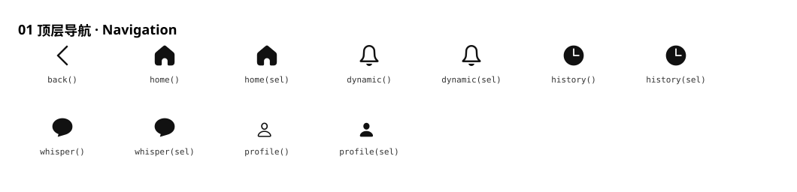
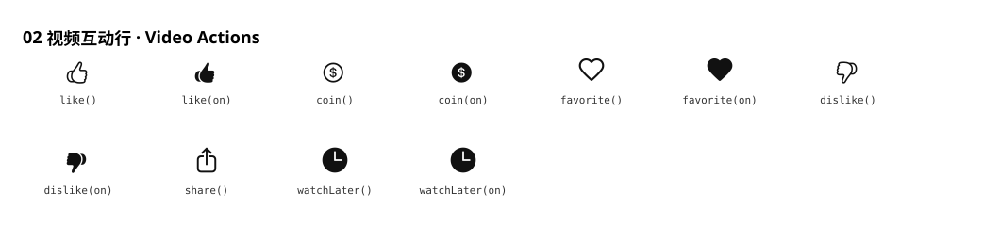
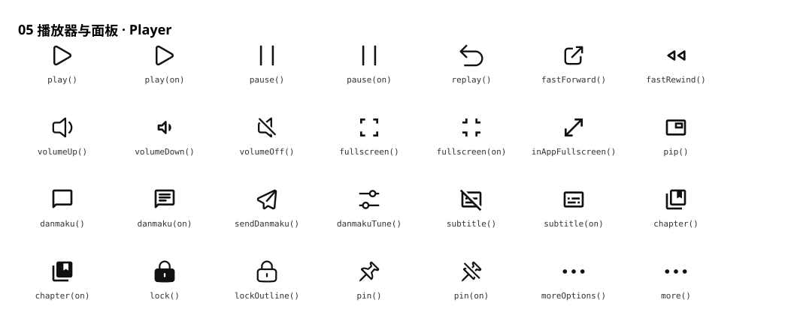
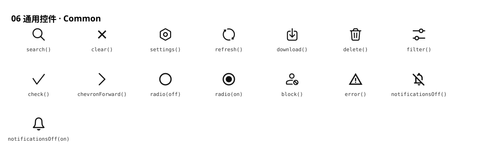
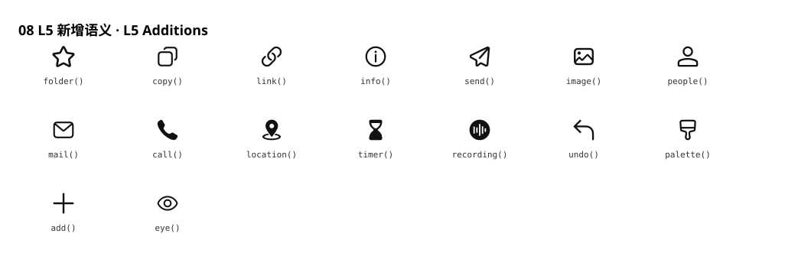

# WinWin 图标体系对照总表（Miuix 矢量 × Cupertino 字形）

> 阶段：5e-L5-4 收官（2026-10-05）｜ 维护入口：`lib/theme/app_icons.dart`
> 本表细化到**项目全部交互图标**：语义方法 → Cupertino 字形 → Miuix 矢量来源 →
> 渲染状态 → 使用位置。新增图标请按「附录 C 流程」操作。
>
> **视觉对照**：Markdown 自身无法渲染图标字体（Cupertino 私有区）与矢量路径，
> 因此各节内嵌由 `test/tools/icon_sheet_test.dart` 生成的 **SVG 全真矢量拼图**
> （`docs/icon-sheets/*.svg`：Miuix 矢量 path 展平 + Cupertino 字形轮廓提取，
> 轮廓表由 `tools/glyph_outline_export.py` 预生成；同目录保留同名 PNG 实渲染
> 备份）。改动图标后重跑该测试即自动重建两套资源。

## 一、渲染链路与图标集规模

**链路**：`AppIcons 语义方法`（无参静态，返回 Cupertino 字形）
→ `AppIcon` 部件（读 `IconTheme` 颜色/尺寸 + `Center(width/heightFactor:1)` 宽松化）
→ `miuixVectorForGlyph` 映射表（52 键）
→ 命中：`MiuixIcon(矢量)`；未命中：`Icon(Cupertino 字形)` 回退。

| 图标集 | 规模 | 说明 |
|---|---|---|
| Cupertino（cupertino_ui） | **1322 字形** | 全量字形池（回退来源） |
| Miuix extended | **156** | 主映射来源 |
| Miuix basic | **7**（check/close/search/sidebar/arrowRight/arrowUpDown/searchCleanup） | 基础集 |
| Miuix OS4 | **176**（×5 字重，`MiuixIcons.os4.byName`） | 补充映射来源（L5-4 启用） |
| **Miuix 合计启用** | **≈163**（extended+basic 全用，OS4 按需） | 约为 Cupertino 的 **1/8** |

## 二、全量语义对照表（细化到所有交互图标）

状态：✅ = 渲染 Miuix 矢量（**⚠️ 已清零**：阶段5e-L5-5 起 16 个「三集无对应」
语义由**内置矢量**补齐——轮廓与 Cupertino 回退字形等价、零视觉变更，
但统一走矢量管线、脱离字体依赖；数据见 `lib/theme/app_icons_builtin.g.dart`）。
「曾用（Material）」列为**迁移前字形的实渲染**（L3 前 M3 分支 / L5 归一记录，
轮廓来自 Flutter SDK MaterialIcons 字体）——与「现用」并排供对照挑选；表格内嵌
**PNG 行内图**（编辑器预览兼容性最好），单图标另有全真矢量 SVG 版：
`docs/icon-sheets/icons/`（`<key>.png|svg` 现用、`<key>-old.png|svg` 曾用）。
表格由 `test/tools/icon_sheet_test.dart` 自动生成（`tables/*.md`）。

### ① 顶层导航（底栏 5 项 + 侧栏 + 返回）

| 语义 | 使用位置 | 曾用（Material） | 现用（最终视觉） | Cupertino 字形 | 矢量 | 状态 |
|---|---|---|---|---|---|---|
| `back()` | 全局返回（AppBackButton） |  |  | `chevron_back` | chevronBackward | ✅ |
| `home()` | 底栏/侧栏「首页」 |  |  | `house` | home | ✅ |
| `home(sel)` | 底栏/侧栏「首页」选中 |  |  | `house_fill` | home | ✅ |
| `dynamic()` | 底栏/侧栏「动态」 |  |  | `bell` | notifications（OS4） | ✅ |
| `dynamic(sel)` | 底栏/侧栏「动态」选中 |  |  | `bell_fill` | notifications（OS4） | ✅ |
| `history()` | 底栏/侧栏「历史」 |  |  | `clock` | recent | ✅ |
| `history(sel)` | 底栏/侧栏「历史」选中 |  |  | `clock_fill` | recent | ✅ |
| `whisper()` | 底栏/侧栏「消息」+ 动态评论数 |  |  | `chat_bubble_2` | messages | ✅ |
| `whisper(sel)` | 底栏/侧栏「消息」选中 |  |  | `chat_bubble_2_fill` | messages | ✅ |
| `profile()` | 底栏/侧栏「我的」+ 头像占位 |  |  | `person` | 内置矢量 | ✅ |
| `profile(sel)` | 底栏/侧栏「我的」选中 |  |  | `person_fill` | 内置矢量 | ✅ |

### ② 视频互动行（video_action_row，6 按钮）

| 语义 | 使用位置 | 曾用（Material） | 现用（最终视觉） | Cupertino 字形 | 矢量 | 状态 |
|---|---|---|---|---|---|---|
| `like()` | 视频点赞 |  |  | `hand_thumbsup` | 内置矢量 | ✅ |
| `like(on)` | 视频点赞（已赞） |  |  | `hand_thumbsup_fill` | 内置矢量 | ✅ |
| `coin()` | 投币 |  |  | `money_dollar_circle` | 内置矢量 | ✅ |
| `coin(on)` | 投币（已投） |  |  | `money_dollar_circle_fill` | 内置矢量 | ✅ |
| `favorite()` | 收藏 |  |  | `star` | favorites | ✅ |
| `favorite(on)` | 收藏（已藏） |  |  | `star_fill` | favoritesFill | ✅ |
| `dislike()` | 点踩 |  |  | `hand_thumbsdown` | 内置矢量 | ✅ |
| `dislike(on)` | 点踩（已踩） |  |  | `hand_thumbsdown_fill` | 内置矢量 | ✅ |
| `share()` | 分享 |  |  | `share` | share | ✅ |
| `watchLater()` | 稍后再看 |  |  | `clock` | recent | ✅ |
| `watchLater(on)` | 稍后再看（已加） |  |  | `clock_fill` | recent | ✅ |

### ③ 动态互动条（dyn_action_bar，动态卡片/详情/空间共用）

| 语义 | 使用位置 | 曾用（Material） | 现用（最终视觉） | Cupertino 字形 | 矢量 | 状态 |
|---|---|---|---|---|---|---|
| `reply()` | 转发/回复 |  |  | `reply` | reply | ✅ |
| `whisper()` | 评论 |  |  | `chat_bubble_2` | messages | ✅ |
| `like()` | 点赞 |  |  | `hand_thumbsup` | 内置矢量 | ✅ |

### ④ 评论区（视频/番剧 评论项与楼中楼）

| 语义 | 使用位置 | 曾用（Material） | 现用（最终视觉） | Cupertino 字形 | 矢量 | 状态 |
|---|---|---|---|---|---|---|
| `like(on)` | 评论点赞 |  |  | `hand_thumbsup_fill` | 内置矢量 | ✅ |
| `dislike()` | 评论点踩 |  |  | `hand_thumbsdown` | 内置矢量 | ✅ |
| `reply()` | 评论回复 |  |  | `reply` | reply | ✅ |
| `expandMore()` | 展开更多回复/排序 |  |  | `chevron_down` | expandMore | ✅ |
| `chevronUp()` | 楼中楼折叠 |  |  | `chevron_up` | expandLess | ✅ |
| `chevronDown()` | 展开箭头 |  |  | `chevron_down` | expandMore | ✅ |

### ⑤ 播放器控制条与面板（player_panel / danmaku / subtitle / 倍速）

| 语义 | 使用位置 | 曾用（Material） | 现用（最终视觉） | Cupertino 字形 | 矢量 | 状态 |
|---|---|---|---|---|---|---|
| `play()` | 播放 |  |  | `play` | play | ✅ |
| `play(on)` | 播放（激活） |  |  | `play_fill` | play | ✅ |
| `pause()` | 暂停 |  |  | `pause` | pause | ✅ |
| `pause(on)` | 暂停（激活） |  |  | `pause_fill` | pause | ✅ |
| `replay()` | 重播 |  |  | `restart` | reset（OS4） | ✅ |
| `fastForward()` | 快进 |  |  | `forward_fill` | forward | ✅ |
| `fastRewind()` | 快退 |  |  | `backward_fill` | 内置矢量 | ✅ |
| `volumeUp()` | 音量 — 大 |  |  | `speaker_3_fill` | volumeUp | ✅ |
| `volumeDown()` | 音量 — 小 |  |  | `speaker_1_fill` | 内置矢量 | ✅ |
| `volumeOff()` | 静音 |  |  | `speaker_slash_fill` | volumeOff | ✅ |
| `fullscreen()` | 全屏 |  |  | `fullscreen` | 内置矢量 | ✅ |
| `fullscreen(on)` | 退出全屏 |  |  | `fullscreen_exit` | 内置矢量 | ✅ |
| `inAppFullscreen()` | 网页全屏 |  |  | `square` | 内置矢量 | ✅ |
| `pip()` | 画中画 |  |  | `tv` | 内置矢量 | ✅ |
| `danmaku()` | 弹幕开关 |  |  | `chat_bubble` | messages（OS4） | ✅ |
| `danmaku(on)` | 弹幕开关（开） |  |  | `chat_bubble_fill` | messages（OS4） | ✅ |
| `sendDanmaku()` | 发送弹幕 |  |  | `bubble_left` | send（OS4） | ✅ |
| `danmakuTune()` | 弹幕设置 |  |  | `slider_horizontal_3` | tune | ✅ |
| `subtitle()` | 字幕开关 |  |  | `captions_bubble` | 内置矢量 | ✅ |
| `subtitle(on)` | 字幕开关（开） |  |  | `captions_bubble_fill` | 内置矢量 | ✅ |
| `chapter()` | 章节 |  |  | `bookmark` | 内置矢量 | ✅ |
| `chapter(on)` | 章节（展开） |  |  | `bookmark_fill` | 内置矢量 | ✅ |
| `lock()` | 全屏锁定 |  |  | `lock_fill` | lock | ✅ |
| `lockOutline()` | 解锁 |  |  | `lock` | lock | ✅ |
| `pin()` | 置顶 |  |  | `pin_fill` | pin | ✅ |
| `pin(on)` | 取消置顶 |  |  | `pin_slash_fill` | unpin | ✅ |
| `moreOptions()` | 更多选项（会话/用户空间） |  |  | `ellipsis` | more | ✅ |
| `more()` | 更多（通用） |  |  | `ellipsis` | more | ✅ |

### ⑥ 通用控件与对话框

| 语义 | 使用位置 | 曾用（Material） | 现用（最终视觉） | Cupertino 字形 | 矢量 | 状态 |
|---|---|---|---|---|---|---|
| `search()` | 搜索框（首页/搜索页） |  |  | `search` | search | ✅ |
| `clear()` | 清除/关闭 |  |  | `clear` | Close | ✅ |
| `settings()` | 设置入口 |  |  | `settings` | settings | ✅ |
| `refresh()` | 刷新 |  |  | `refresh` | refresh | ✅ |
| `download()` | 下载/保存图片 |  |  | `arrow_down_to_line` | download | ✅ |
| `delete()` | 删除/清理 |  |  | `delete` | delete | ✅ |
| `filter()` | 排序/筛选 |  |  | `slider_horizontal_3` | tune | ✅ |
| `check()` | 勾选（多选/成功） |  |  | `checkmark` | ok | ✅ |
| `chevronForward()` | 前进箭头（列表行/个人页） |  |  | `chevron_forward` | chevronForward | ✅ |
| `radio(off)` | 单选框（SelectDialog） |  |  | `circle` | 内置矢量 | ✅ |
| `radio(on)` | 单选框（选中） |  |  | `check_mark_circled_solid` | 内置矢量 | ✅ |
| `block()` | 屏蔽/封禁 |  |  | `slash_circle` | blocklist | ✅ |
| `error()` | 错误/告警 |  |  | `exclamationmark_circle` | 内置矢量 | ✅ |
| `notificationsOff()` | 免打扰（关） |  |  | `bell_slash` | 内置矢量 | ✅ |
| `notificationsOff(on)` | 免打扰（开） |  |  | `bell_fill` | notifications（OS4） | ✅ |

### ⑦ 元数据行（视频卡片/动态/收藏）

| 语义 | 使用位置 | 曾用（Material） | 现用（最终视觉） | Cupertino 字形 | 矢量 | 状态 |
|---|---|---|---|---|---|---|
| `viewCount()` | 播放量 |  |  | `play_circle` | 内置矢量 | ✅ |
| `danmakuCount()` | 弹幕数 |  |  | `captions_bubble` | 内置矢量 | ✅ |
| `duration()` | 时长 |  |  | `clock` | recent | ✅ |
| `calendar()` | 发布日期 |  |  | `calendar` | 内置矢量 | ✅ |

### ⑧ L5 新增语义（B/C 类字形归一，全部矢量）

| 语义 | 使用位置 | 曾用（Material） | 现用（最终视觉） | Cupertino 字形 | 矢量 | 状态 |
|---|---|---|---|---|---|---|
| `folder()` | 收藏夹/公开私密 |  |  | `folder` | folder | ✅ |
| `copy()` | 复制 UID/链接 |  |  | `doc_on_doc` | copy | ✅ |
| `link()` | 打开链接 |  |  | `link` | link | ✅ |
| `info()` | 关于/开源协议 |  |  | `info` | info | ✅ |
| `send()` | 发送/私信 |  |  | `paperplane` | send | ✅ |
| `image()` | 相册/图片 |  |  | `photo` | image | ✅ |
| `people()` | 用户群组 |  |  | `person_2` | contacts | ✅ |
| `mail()` | 私信 |  |  | `mail` | email | ✅ |
| `call()` | 客服 |  |  | `phone` | phone | ✅ |
| `location()` | 定位（IP 属地） |  |  | `location` | location | ✅ |
| `timer()` | 定时（稍后提醒） |  |  | `timer` | timer | ✅ |
| `recording()` | 录制中（LIVE 点） |  |  | `circle_fill` | recording | ✅ |
| `undo()` | 撤销 |  |  | `arrow_uturn_left` | undo | ✅ |
| `palette()` | 主题/彩色弹幕 |  |  | `paintbrush` | theme | ✅ |
| `add()` | 关注（+ 按钮） |  |  | `add` | add | ✅ |
| `eye()` | 浏览/阅读数 |  |  | `eye` | show | ✅ |

**统计**：已用语义 **71 个** → ✅ 矢量 **71 个（100%）**：其中 52 键为 Miuix
三集映射（extended/basic/OS4），16 个语义（涉及的 24 个字形）为**内置矢量补齐**
（L5-5：点赞/点踩/投币、单人剪影、全屏系、画中画、音量小、字幕、章节、单选框、
错误、播放量/弹幕数/日历、免打扰铃铛）。⚠️ 回退 **0 个**——全站图标统一矢量管线。

## 三、残余裸 `Icons.*`（非语义化直参，95 处 / 78 字形）

> 均为**有意保留**：播放器/设置/登录页专属字形或 `.fontFamily` 元数据
> （非图标渲染）。重头已随 L5 各波清零（293 → 95，消除 67.6%）。

| 模块 | 示例字形 | 说明 |
|---|---|---|
| 登录页 | `login`×6、`qr_code_2`、`verified_user_outlined` | 无 Cupertino/Miuix 对应 |
| 断网空态 | `cloud_off_outlined`×5 | 无矢量对应 |
| 设置项 | `touch_app_outlined`、`video_settings_outlined`、`brightness_6_outlined`、`style_outlined`、`cookie_outlined` 等 | 功能专属字形 |
| 播放器/直播 | `playlist_play`、`sensors(_off)`、`flash_on_outlined`、`hd_outlined`、`aspect_ratio` 等 | 播放器专属 |
| 其他 | `arrow_drop_down`、`chevron_left`、`swap_horiz`、`history_toggle_off`、`report_outlined`、`bug_report_outlined` 等 | 零散待评估 |

`level_icon.dart` 的 `Icons.bolt_rounded.fontFamily` 等为**字体元数据**（自绘等级
数字），不得转换。

## 四、维护约定

1. **新增图标**：优先查三集（extended → OS4 → basic）是否已有对应；有则
   在 `AppIcons` 加语义方法 + 映射表加键；无则回退 Cupertino 字形并在
   本表「⚠️」区登记。
2. **不得**在业务代码直写 `Icon(Icons.*)`；一律走 `AppIcon(AppIcons.*())`
   （渲染链路统一承担 IconTheme 颜色/尺寸继承与约束宽松化）。
3. **回归**：`test/ui/components/miuix_adoption_test.dart` 维护映射表初始化
   安全用例（byName 拼写错误会在此抛错）；`test/theme/app_icons_test.dart`
   锁定语义→字形对照。

## 附录 A：源码位置

- 语义中心 + 映射表：`lib/theme/app_icons.dart`（AppIcons / AppIcon /
  AppBackButton / `_miuixVectorByGlyph` 52 键）
- 图标映射测试：`test/theme/app_icons_test.dart`、`test/ui/components/miuix_adoption_test.dart`

## 附录 B：OS4 备选池与内置矢量（L5-5）

- 三集（extended/basic/OS4）现覆盖 52 键；剩余 24 个字形走**内置矢量**
  （`app_icons_builtin.g.dart`，轮廓提取自 Cupertino 字体、MIT 许可注明）。
- 若想把内置矢量升级为**全新 Miuix 风格美术**（如以 OS4 `gift`/`coupon` 代投币、
  重绘拇指等），可基于本表逐枚评审替换——当前状态为"零视觉变更的管线统一"。

## 附录 C：新增图标流程

1. `AppIcons` 增加语义方法（返回 Cupertino 字形）；
2. `_miuixVectorByGlyph` 增加 `Cupertino字形 → MiuixIcons.{extended|os4|basic}` 键；
3. 在 `miuix_adoption_test` 映射安全用例加非空断言；
4. 本表对应行状态从 ⚠️ 改 ✅；
5. `dart analyze` 0 → `flutter test` 全绿 → 双构建 → 提交。
